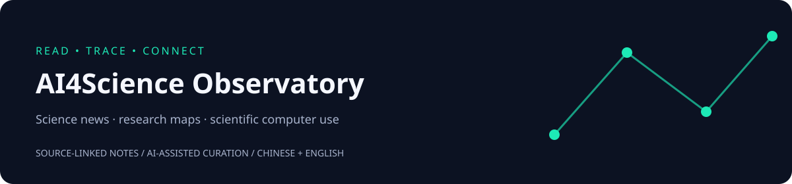

# AI4Science Observatory

 

**Source-linked AI for Science news, research catalogs, and scientific computer-use reading notes.**

有来源可追溯的 AI4Science 知识观察站：把科学新闻、跨学科论文目录、科学软件操作与远程实验放在同一条“问题—方法—证据”链上。

[最新科学日报](digests/ai4science/2026/2026-10-10.md) · [最新晨读](digests/scientific-computer-use/2026/2026-10-10.md) · [主题导航](topics/README.md) · [全部书目](resources/papers.md) · [日期归档](digests/README.md) · [参与贡献](CONTRIBUTING.md)

## What you will find

| 入口 | 内容 |
| --- | --- |
| [AI4Science daily](digests/README.md#ai4science-daily) | 17 期新闻解读，182 个去重事件 |
| [Scientific computer use](resources/papers.md) | 11 期晨读，45 项资料，含远程真实实验 |
| [Source directory](resources/sources.md) | 170 个带历史核验的信源 |
| [Research & industry data](data/README.md) | 11 份 CSV：论文、综述、融资、招聘与研究项目 |

## Start reading

最新变化从顶部日报进入；按问题探索可使用主题导航；批量分析见 [Data Guide](data/README.md)。当前晨读范围 2026-09-28 至 2026-10-10，有新材料时更新，不补造缺失日期。

## Repository map

~~~text
digests/       # 频道 / 年份 / 日期
topics/        # 主题阅读路径
resources/     # 书目与资源导航
data/          # 可复用 JSON / CSV
docs/          # 编辑、设计与分享说明
templates/     # 统一资料模板
.github/       # Issue / Pull Request 入口
~~~

## Evidence, contributions, and citation

内容由 AI 辅助整理，不代表维护者逐篇实读或独立复现。保留原始来源、作者结论的适用范围与未知条件，见 [Editorial Policy](docs/editorial-policy.md)。

欢迎 [补充与纠错](CONTRIBUTING.md)。原创说明和汇编采用 [CC BY 4.0](LICENSE)，第三方作品保留各自权利。科研结论引用原论文，集合结构可引用 [CITATION.cff](CITATION.cff)。

[Sharing guide](docs/sharing.md) · [Design references](docs/design-references.md) · [Related collection](https://github.com/ppchanning/agent-environment-reading)
